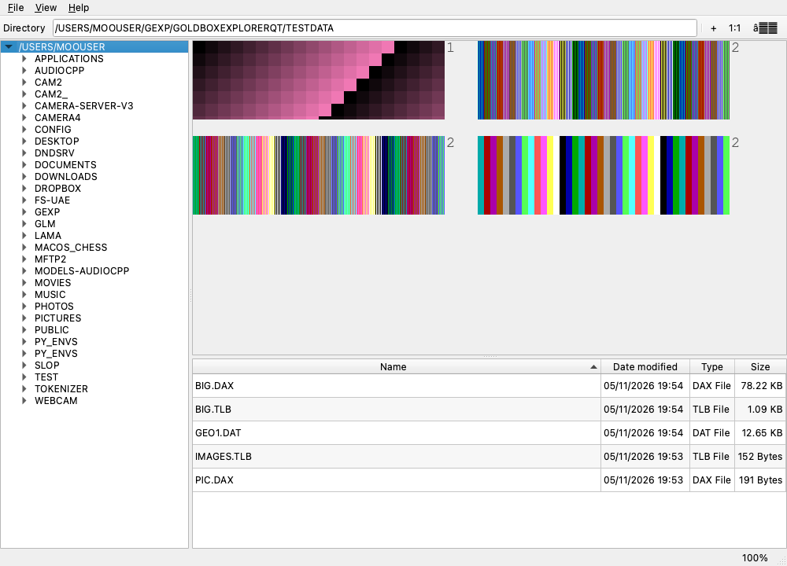

# Gold Box Explorer — Qt port

A cross-platform C++17/Qt 6 port of
[Gold Box Explorer](https://github.com/bsimser/Gold-Box-Explorer), the
Windows/.NET file explorer for SSI's classic *Gold Box* role-playing games
(Pool of Radiance, Curse of the Azure Bonds, Pools of Darkness, the Krynn
games, Unlimited Adventures/FRUA, and the Buck Rogers games).

The original application is C# WinForms targeting .NET Framework 3.5. This
port keeps the same plugin architecture and file-format logic, but renders
through Qt Widgets so it builds and runs on macOS, Linux, and Windows. The
conversion was developed with AI assistance (DeepSeek Flash V4.1).



## Status

Current version: **0.51**.

The macOS build is the primary target and has been exercised with synthetic
DAX/TLB/GEO/ECL/IFF/8SVX/DAA files and with real Amiga *Champions of Krynn*,
*Pool of Radiance*, and *Death Knights of Krynn* installations. The same CMake
project is portable to Linux and Windows.

### Implemented

| Area | Notes |
| --- | --- |
| Main window | Directory tree, sortable file list, zoom menu/toolbar, Ctrl+wheel zoom, status bar, remembered root folder |
| Plugin framework | Same detection order and plugin-per-file design as the original |
| DAX images | VGA, EGA, VGA sprites, EGA sprites, VGA strata, VGA mixed (planar and EGA), 8×8 monochrome, unknown blocks |
| DAX wall sets | `WALLDEF*.DAX` assembly from `8x8d*.DAX`, including 8×8 tile loading and multi-wall-set layouts |
| TLB graphics | TILE and master libraries, drawing methods 16/17/18/21/23, internal/external colour tables, CBODY/CPIC combat icons; big-endian Amiga GLIB libraries with 4-plane (method 0) and 5-plane (method 1) planar images |
| GLB containers | Big/little-endian `GLIB` archives (`.GLB`): container summary, block table with per-block hex, block export, TEXT strings, DIG8 sample playback, ECL strings, item/monster/effect record tables |
| Image export | PNG/BMP/JPEG through the file context menu, same naming scheme as the original exporter |
| Generic viewers | Text, PNG/JPEG/GIF/BMP/TGA/TIFF (as supported by Qt), and a fast hex viewer |
| Amiga audio | 8SVX/16SV IFF audio with waveform preview, metadata, playback, and WAV export; extensionless sounds detected by content |
| Amiga DAX | Big-endian index + ByteKiller depacker; 4-plane planar images, ECL, GEO, WALLDEF, item/monster data, and the `pic`/`sprit`/`final` prefix variant |
| Amiga music/instruments | IFF inspector for `FORM INST` (e.g. `Sound/cast4`), `FORM SMUS` (`Sound/krynn`) with sample-bank-driven playback, embedded sound banks (`Sound/soundData`), and referenced sample playback |
| Amiga song banks | `SLBR` `.SLB` files (Curse/Secret): song table, note/command event view, piano-roll rendering, one Music sub-tab per song with playback/WAV export; `--slb` CLI |
| Music-X modules | `MXTX` `.MX` files (Secret): header summary, six-byte note/velocity/duration sequence, piano roll, square-wave preview, waveform/envelope plot, hex |
| Save files | Amiga `CHRDATA*.sav` character records, `CHRDATA*.swg` equipment slots, `CHRDATA*.fx` effect records, and `SAVGAM*.DAT` summaries |
| Amiga / DAA assets | Native Amiga DAA containers (big-endian index, SSI RLE, 9-byte image header, 64-byte Amiga palette, 5-plane planar images, 8×8 4bpp tile blocks), plus `.DAA`, `.DAI`, `.IFF`, `.LBM`, `.ILBM`, `.ANIM` auto-detection for IFF ILBM/PBM, IFF ANIM base frames, IFF 8SVX audio, and DAX containers; otherwise chunk metadata, strings, and hex |
| Data viewers | FRUA characters (`.SAV`, `.ITM`, `.SPC`, `MON*CHA.DAX` when in Pool of Radiance), item tables, Amiga item/effect DAX records (`ITEM*.DAX`, `MON*ITM.DAX`, `MON*SPC.DAX`, `MON*CHA.DAX`), the Amiga `items` template table, `Sound/periodTable`, `GAME001.DAT`, `SAVGAM*.CSV`, vault files |
| GEO (.DAT) | Module summary and grid dump |
| GEODAX (.DAX) | Per-map 2D renderer with rooms, walls, doors, and events |
| ECL (.DAX) | Per-block extracted strings, combined ECL text, and raw hex |

### Recent additions

- **8SVX/16SV audio viewer.** Parses the IFF `VHDR`, `BODY`, and `NAME`
  chunks, draws a waveform, shows sample rate/size/duration, plays the sample,
  and exports a standard PCM WAV.
  - macOS playback: `afplay`
  - Linux playback: `aplay`, `paplay`, or `ffplay`
  - Windows playback: PowerShell `SoundPlayer`
  - `Save WAV...` works even when no external player is available.
- **Amiga DAA containers.** The native Amiga `.DAA` files use a big-endian
  index followed by SSI run-length-coded blocks. The viewer decodes:
  - the 9-byte image header (`height`, `width` in bytes, `x`, `y`, frame count)
  - the 64-byte Amiga 12-bit palette (32 colours)
  - 5-plane planar images
  - 8×8 4bpp tile blocks (`8X8D*.DAA`)
  Real *Champions of Krynn* Amiga files (`BIGPIC1.DAA`, `HEAD1.DAA`,
  `BODY1.DAA`, `CPIC1.DAA`, `BORDER.DAA`, `SKY.DAA`, `8X8D1.DAA`) decode
  successfully. Multi-frame combat banks and the alternate `pic*.daa` /
  `SPRIT*.DAA` tables are not decoded yet and fall back to the summary/hex
  view.
- **DAA/DAI/IFF asset viewer.** The plugin inspects the file content rather
  than relying only on the extension:
  1. native Amiga DAA container → images
  2. IFF 8SVX/16SV → audio viewer
  3. IFF ILBM/PBM → image viewer (including HAM/EHB and compressed ILBM rows)
  4. IFF ANIM → first available base frame
  5. DAX container → all decoded DAX images
  6. unknown layout → chunk/string summary + hex view
- **Amiga item/effect DAX records.** `ITEM1.DAX`/`ITEM2.DAX` and
  `MON*ITM.DAX` are decoded as 63-byte item records; `MON*SPC.DAX` is decoded
  as 9-byte effect records. The viewer shows a tab per record with the same
  annotated fields as the original character/item viewer.
- **Extension-less Amiga sounds.** The audio plugin now detects 8SVX by IFF
  content, so files such as `Sound/arrow` and `Sound/fireb` open even without
  an extension.
- **IFF instrument and music files.** `Sound/cast4` and `Sound/cast3` are
  `FORM INST` definitions (PTCH/VLUM/SAMP); the viewer shows their references
  and, when the referenced sample exists in the same folder (for example
  `tuningFork` → `Sound/tuningfork`), adds an audio tab for it.
  `Sound/krynn` is decoded as `FORM SMUS` with score header, instruments, and
  track size. A **Music** tab synthesizes the score: INS1 registers are
  matched to the INST definitions in `Sound/soundData`, each INST resolves to
  its 8SVX sample, and the TRAK notes are rendered through those samples at
  the SMUS tempo. A 4-track score such as `krynn` produces about 87 seconds of
  audio and can be played or exported as WAV.
- **Sound banks.** `Sound/soundData` contains multiple nested IFF forms
  (5 × 8SVX plus INST/ENVL definitions); each sample gets its own audio tab
  and the definitions are listed in a summary.
- **Amiga save files.** `CHRDATA*.sav` opens as a character record,
  `CHRDATA*.swg` as 72-byte equipment slots, `CHRDATA*.fx` as 10-byte effect
  records, and `SAVGAM*.DAT` as a summary/string/hex view.
- **Amiga `items` and `Sound/periodTable`.** `items` is shown as a recovered
  256 × 8-byte template table after its 2-byte header; `periodTable` is shown
  as a 320-entry 16-bit table.
- **Alternate DAA banks.** `pic1.daa`, `pic2.daa`, `SPRIT1.DAA`, and
  `SPRIT2.DAA` are parsed with their 6-byte index. The Records tab lists each
  decoded block with its little-endian height/width/x/y/frame header and
  palette entry 0. `DUNGCOM.DAA`, `WILDCOM.DAA`, and `RANDCOM.DAA` show their
  DAA block and image-header fields in the Summary tab. Their pixel packing is
  still not decoded.
- **Amiga Pool of Radiance DAX.** The pool `.dax` files use a different
  container from the DOS DAX: a big-endian index and ByteKiller-packed
  blocks. The port reads both transparently. `8x8d.dax`, `head.dax`,
  `body.dax`, `cpic.dax`, `comspr.dax`, `icon.dax`, `bacpac.dax`,
  `sqrpaci.dax`, `pic.dax`, `sprit.dax`, `final.dax`, `dungcom.dax`,
  `randcom.dax`, and `wildcom.dax` all decode to images. `ecl.dax` and
  `geo.dax` decode through the existing ECL/GEO viewers, and `walldef.dax`
  assembles wall sets from the Amiga `8x8d.dax` tiles.
- **Amiga Pool item/monster DAX.** `item.dax` and `monitm.dax` are shown as
  decoded name tables; `moncha.dax` as a monster table with name and stat
  bytes; `monspc.dax` through the effect record viewer.
- **Amiga font metadata.** `poolrad.font`/`protect.font` expose their font
  header, name, and data size.
- **Death Knights of Krynn.** The `dkk` test set decodes `8x8d1.daa`,
  `BACK1.DAA`, `BIGPIC1.DAA`, `BORDER.DAA`, `COMSPR.DAA`, `CPIC1.daa`,
  `PIC1.DAA` (record table), `DUNGCOM.daa`/`WILDCOM.daa` (block/header
  summary), `globals.daa` (summary), `ECL1.DAX`, `GEO1.DAX`,
  `walldef1.dax`, `ITEM0.DAX`, `MON1CHA.DAX`, `MON1ITM.DAX`,
  `MON1SPC.DAX`, `MON1WIZ.DAX` (block table), and the LBM title screens.
  The seven `sound/*.smu` scores play through `sound/soundData` samples.
- **SMUS sample playback.** `sound/krynn.smu` and the DKK scores resolve
  INS1 → INST → SAMP → 8SVX and produce a playable Music tab.
- **Curse of the Azure Bonds / Secret of the Silver Blades.** The Amiga
  versions use big-endian `GLIB` containers (`.TLB`/`.GLB`). The TLB reader
  now auto-detects the byte order and decodes the planar Amiga images:
  `CPIC.TLB`, `CBODY.TLB`, `CHEAD.TLB`, `COMSPR.TLB`, `DUNGCOM.TLB`, and
  `ALWAYS.TLB` render, and nested master libraries such as `BIGPIC.TLB`,
  `8X8D.TLB`, and `TILES.TLB` are opened. `ITEMS.DAT`, `SAVGAM*.DAT`/`.sav`,
  `VAULT.DAT`, and the text files are recognised. The specialised `.GLB`
  data containers (`ECL.GLB`, `GEO.GLB`, `ITEM.GLB`, `MONCHA.GLB`,
  `MONITM.GLB`, `MONSPC.GLB`, `WALLDEF.GLB`), `STRINGS.GLB`, and
  `SOUNDS.GLB` open through the new GLIB viewer: container summary, block
  table, per-block hex, block export, strings, sample playback, ECL strings,
  and item/monster/effect tables. `SECRET.SLB` and `CURSE.SLB` are decoded as
  `SLBR` song banks: four songs for Secret and nine (three main themes plus
  short jingles) for Curse, each shown with note events, loop point, piano
  roll, and a dedicated Music sub-tab with a synthesized square-wave preview. Compressed master libraries such as
  Secret of the Silver Blades `BIGPIC.TLB`, `PIC.TLB`, and `8X8D.TLB` are
  routed to the container view, where their nested blocks and ID table can
  be inspected and exported. The bitmap font, the `.SLB` sound library, and
  the Amiga `.guy` character files still fall back to the hex/summary view.
- **New test assets and tests.** Synthetic `TEST.8SVX`, `TEST.DAA`,
  `TESTDAA.DAA`, `TEST.ANIM`, `TEST-LBM.IFF`, `DAXIN.DAA`, and
  `UNKNOWN.DAA` files are generated by `tools/make_testdata.py`.

### Not ported yet

These are the only remaining differences from the original application. They
were re-checked against the current source before this README update:

- **ECL bytecode disassembler/decompiler.** The upstream `EclDump`
  (`Commands.cs`, `Program.cs`, `Memory.cs`, `Sys.cs`) is not ported. The
  current ECL viewer exposes extracted strings, combined text, and raw hex,
  not decoded instructions.
- **GeoDAX first-person 3D view.** The current GeoDAX viewer is the 2D map
  renderer; the first-person view, movement, map navigation, and ECL
  cross-linking are still missing.
- **“Export to Wall Template” form.** The specialised wall/overlay template
  exporter is not ported. The generic PNG/BMP/JPEG image export does export
  the decoded wall images.

Everything else in the original `src/Common` and `src/Explorer` projects has
a C++/Qt counterpart.

## Build

### macOS

```sh
brew install qt cmake ninja

cmake -S . -B build -G Ninja -DCMAKE_PREFIX_PATH="$(brew --prefix qt)"
cmake --build build
open build/gbexplorer.app
```

If Homebrew installed only the `qtbase` formula, point CMake at that prefix
instead:

```sh
cmake -S . -B build -G Ninja -DCMAKE_PREFIX_PATH="$(brew --prefix qtbase)"
```

### Linux

```sh
sudo apt install qt6-base-dev cmake ninja-build   # Debian/Ubuntu
cmake -S . -B build -G Ninja
cmake --build build
./build/gbexplorer
```

### Windows

Install Qt 6 (MSVC kit), CMake, and Visual Studio, then:

```bat
cmake -S . -B build -G "Visual Studio 17 2022" ^
      -DCMAKE_PREFIX_PATH=C:/Qt/6.8.0/msvc2022_64
cmake --build build --config Release
```

The target is built as a GUI application (`WIN32_EXECUTABLE`) on Windows and
as a `.app` bundle on macOS.

### Packaging the macOS app

For a standalone bundle that does not depend on Homebrew's Qt installation:

```sh
"$(brew --prefix qt)/bin/macdeployqt" build/gbexplorer.app
```

Use `$(brew --prefix qtbase)/bin/macdeployqt` if Qt was installed as
`qtbase` only.

## Using the application

1. Click the directory field in the toolbar (or use **File → Open Folder**) to
   choose the folder containing the game files.
2. Browse the tree on the left and select a file in the list; its viewer opens
   above the list.
3. Change zoom from **View → Zoom**, with the toolbar buttons, or with
   Ctrl/Cmd + mouse wheel.
4. Right-click a file (or use **File → Export**) to export decoded images as
   PNG, BMP, or JPEG.
5. Select an `.8SVX`, `.SVX`, or `.16SV` file to open the audio viewer. Use
   **Play**, **Stop**, or **Save WAV...**.
6. Select a `.DAA`, `.DAI`, `.IFF`, `.LBM`, `.ILBM`, or `.ANIM` file; the
   content is inspected automatically and the appropriate image, audio, DAX,
   or summary viewer is opened.

The root folder is stored with `QSettings` under the `GoldBoxExplorer` /
`GoldBoxExplorerQt` organization/application names.

### Format limitations

- Compressed 8SVX audio (Fibonacci/EXP delta) is detected but not decoded; the
  viewer reports the compression type instead of showing a waveform.
- The native DAA container is decoded for single-frame planar images and
  8×8 tile banks. Multi-frame combat banks (`DUNGCOM.DAA`, `WILDCOM.DAA`,
  `RANDCOM.DAA`) and the alternate `pic*.daa` / `SPRIT*.DAA` /
  `PIC1.DAA` layouts are indexed and summarized, including their record
  headers, but their pixel packing is not decoded yet. `globals.daa` and
  `pointers.daa` remain summary/hex only.
- The Amiga Pool DAX image palette is not stored in the image blocks; the
  preview uses the 16-colour EGA palette, so the shapes are correct but the
  colours are an approximation of the Amiga palette.
- Amiga hunk executables (`main`, `program`, `run`, `fastmemfirst`, `intro`,
  `game`, `poolrad/8`, `protect/8`) and launcher/config files (`AssignCOK`,
  `system-configuration`, `c/*`, `s/*`) are deliberately left out of the
  content viewers.
- SMUS playback is a wavetable preview, not a cycle-accurate Paula/Amiga
  music-driver emulation. It follows the score tempo, notes, instruments, and
  sample assignments, but does not emulate every hardware envelope/effect.
- `MON*CHA.DAX` (Amiga character records, 409-byte blocks) uses the Pool of
  Radiance annotation layout as a best-effort viewer; the extra Amiga bytes
  are not annotated yet.
- The `items` template field names are not documented in the original
  application, so the viewer exposes the eight bytes of each template rather
  than named fields.
- `.DAA` is not a single standard format. IFF, ANIM, DAX, and the native
  Gold Box DAA container are decoded automatically. A proprietary layout that
  is none of these still gets the structural summary and hex view, but would
  need a format sample or specification for a dedicated decoder.

## Testing

Generate synthetic files (no copyrighted game data is included):

```sh
python3 tools/make_testdata.py
```

Probe a file without opening a window:

```sh
QT_QPA_PLATFORM=offscreen ./build/gbexplorer.app/Contents/MacOS/gbexplorer \
    --probe testdata/BIG.DAX
```

`--probe` prints the plugin selected and the decoded image sizes.

A window-level smoke test loads a file, processes events, and saves a
screenshot to `/tmp/gbexplorer_smoke.png`:

```sh
QT_QPA_PLATFORM=offscreen ./build/gbexplorer.app/Contents/MacOS/gbexplorer \
    --smoke testdata/BIG.DAX
```

Audio parsing and WAV conversion can be checked without a window:

```sh
QT_QPA_PLATFORM=offscreen ./build/gbexplorer.app/Contents/MacOS/gbexplorer \
    --audio testdata/TEST.8SVX
# writes /tmp/gbexplorer_audio.wav
```

SMUS playback can be rendered and inspected without the GUI:

```sh
QT_QPA_PLATFORM=offscreen ./build/gbexplorer.app/Contents/MacOS/gbexplorer \
    --smus "/path/to/Sound/krynn"
# writes /tmp/gbexplorer_smus.wav
```

Run the CTest suite:

```sh
ctest --test-dir build --output-on-failure
```

Current result: **17/17 tests passed**, covering the DAX renderers, TLB
decoding, native DAA containers, IFF/ANIM images, IFF INST instruments,
DAX-in-DAA, item-record DAX viewing, and 8SVX audio parsing/WAV output.

On Linux/Windows use `./build/gbexplorer` (or the `.exe`) instead of the
bundle path.

## Project layout

```
src/
  MainWindow.*          Main browser window (tree, file list, zoom, export)
  ExportDialog.*        Image export dialog
  core/                 ByteReader, DAX container reader, game detection
  dax/                  Palette, render blocks, image file, wall sets
  tbl/                  TLB reader and image decoding
  parse/                Character/item/GEO/GEODAX/ECL parsers, IFF and 8SVX readers, name tables
  widgets/              Image sheet, hex, character, and audio views
  plugins/              Plugin interface, factory, and concrete plugins
tools/make_testdata.py  Synthetic file generator
testdata/               Generated smoke-test files
```

See [PORTING.md](PORTING.md) for the class-by-class mapping from the C#
original to this port and the behaviour differences.

## License

MIT. The original Gold Box Explorer is Copyright (c) 2018 Bil Simser; see
[LICENSE](LICENSE). Game file formats and trademarked game names belong to
their respective owners.
