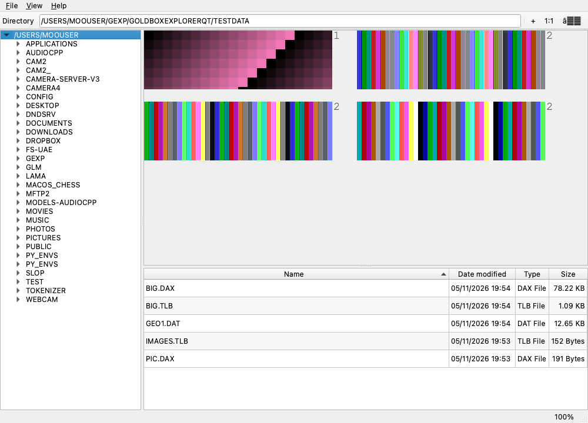

# Why ?

Because it's fun to do the must unuseful thing in the universe.

Because i've always loved role-playing and CRPGs. 

SSI games in particular are the ones i played in my childhood, and i still replay them once in a while (not only Goldbox marvels but also Darksun: Shattered lands and Darksun: Wake of the ravager [you should really play them!]).

Aaaand, praise to the great Baldur's Gate 3 (thanks Larian!).

# Gold Box Explorer — Qt port

A cross-platform C++17/Qt 6 port of
[Gold Box Explorer](https://github.com/bsimser/Gold-Box-Explorer), the
Windows/.NET file explorer for SSI's classic *Gold Box* role-playing games
(Pool of Radiance, Curse of the Azure Bonds, Pools of Darkness, the Krynn
games, Unlimited Adventures/FRUA, and the Buck Rogers games).

The original application is C# WinForms targeting .NET Framework 3.5. This
port keeps the same plugin architecture and file-format logic, but renders
through Qt Widgets so it builds and runs on macOS, Linux, and Windows. The
conversion was developed with AI assistance (DeepSeek Flash V4.1).



## Status

Current version: **1.00**.

The macOS build is the primary target and has been exercised with synthetic
DAX/TLB/GEO/ECL/IFF/8SVX/DAA files and with real Amiga *Champions of Krynn*,
*Pool of Radiance*, and *Death Knights of Krynn* installations. The Amiga disks
of *Curse of the Azure Bonds*, *Secret of the Silver Blades*, *Pools of
Darkness* and *Dark Queen of Krynn* open too, including their compressed GLIB
picture libraries (docs/AMIGA_GLIB.md, docs/DKK_POR.md). The same CMake
project is portable to Linux and Windows.

### Implemented

| Area | Notes |
| --- | --- |
| Main window | Directory tree, sortable file list, zoom menu/toolbar, Ctrl+wheel zoom, status bar, remembered root folder |
| Plugin framework | Same detection order and plugin-per-file design as the original |
| Disk images and ZIP | Clicking an `.adf` (AmigaDOS OFS/FFS, DD or HD) or a `.zip` extracts it into `tmp` next to the executable and shows it as an `[ADF]`/`[ZIP]` folder of the tree; the disk images inside a ZIP are extracted too and the first one is shown. The ZIP reader has its own deflate decoder (methods stored and deflate, ZIP64, UTF-8 names, CRC check; encrypted entries and other methods are reported). `tmp` is emptied at start and deleted at exit. CLI: `--adf FILE [OUTDIR]`, `--zip FILE [OUTDIR]` |
| DAX images | VGA, EGA, VGA sprites, EGA sprites, VGA strata, VGA mixed (planar and EGA), 8×8 monochrome, unknown blocks |
| DAX wall sets | `WALLDEF*.DAX` assembly from `8x8d*.DAX`, including 8×8 tile loading and multi-wall-set layouts; magenta transparency; `Export wall template...` dialog with overlay-difference mode |
| TLB graphics | TILE and master libraries, drawing methods 16/17/18/21/23, internal/external colour tables, CBODY/CPIC combat icons; big-endian Amiga GLIB libraries with 4-plane (method 0) and 5-plane (method 1) planar images |
| GLB containers | Big/little-endian `GLIB` archives (`.GLB`): container summary, block table with per-block hex, block export, TEXT strings, DIG8 sample playback, ECL strings, item/monster/effect record tables |
| Image export | PNG/BMP/JPEG through the file context menu, same naming scheme as the original exporter |
| Generic viewers | Text, PNG/JPEG/GIF/BMP/TGA/TIFF (as supported by Qt), and a fast hex viewer. The tabs that show pictures, maps or sounds come first. Sounds and music: a play position line (click or drag to move it, Play goes on from there), one sound at a time |
| Fonts | The 8x8 `.FON` fonts of the Amiga Gold Box games (`CURSE.FON`, `SECRET.FON`, `pod.fon`, `GAME.FON`): character sheet with zoom and a text preview |
| Amiga audio | 8SVX/16SV IFF audio with waveform preview, metadata, playback, and WAV export; extensionless sounds detected by content |
| Amiga DAX | Big-endian index + ByteKiller depacker; 4-plane planar images, ECL, GEO, WALLDEF, item/monster data, and the `pic`/`sprit`/`final` prefix variant |
| Amiga music/instruments | IFF inspector for `FORM INST` (e.g. `Sound/cast4`), `FORM SMUS` (`Sound/krynn`) with sample-bank-driven playback, embedded sound banks (`Sound/soundData`), and referenced sample playback |
| Amiga song banks | `SLBR` `.SLB` files (`CURSE.SLB`, `SECRET.SLB`, `MUSIC.SLB`): the music of Curse of the Azure Bonds, and the fallback music of Secret, Pools and Dark Queen. Songs of up to five tracks played with the game's own sequencer (Secret's variant skips the first track) and sawtooth synth on emulated Paula (checked against the original code run in the 68000 interpreter), track event tables, piano roll, playback/WAV export; `--slb FILE [SONG OUT.wav]` |
| MX music | `MXTX` `.MX` files (Secret, Pools, Dark Queen): songs played with the reconstructed MX driver (sampled instruments, envelopes, four Paula voices; Dark Queen's or Secret/Pools' note timing by file name), checked frame by frame against the games' own drivers run in the 68000 interpreter (`tools/mx_driver_compare.cpp`); event tables, instruments, samples, hex; `--mx-render FILE SONG OUT.wav`, `--mx-trace FILE SONG FRAMES` |
| Executable music | Pool of Radiance `program`: a Music tab plays its six songs by running Wally Beben's original player in a built-in 68000 interpreter, with Paula emulated; `--exe-music FILE [SONG OUT.wav]` |
| Save files | Amiga `CHRDATA*.sav` character records, `CHRDATA*.swg` equipment slots, `CHRDATA*.fx` effect records, and `SAVGAM*.DAT` summaries |
| Amiga / DAA assets | Native Amiga DAA containers (big-endian index, SSI RLE, 9-byte image header, 64-byte Amiga palette, 5-plane planar images, 8×8 4bpp tile blocks), plus `.DAA`, `.DAI`, `.IFF`, `.LBM`, `.ILBM`, `.ANIM` auto-detection for IFF ILBM/PBM, IFF ANIM base frames, IFF 8SVX audio, and DAX containers; otherwise chunk metadata, strings, and hex |
| Data viewers | FRUA characters (`.SAV`, `.ITM`, `.SPC`, `MON*CHA.DAX` when in Pool of Radiance), item tables, Amiga item/effect DAX records (`ITEM*.DAX`, `MON*ITM.DAX`, `MON*SPC.DAX`, `MON*CHA.DAX`), the Amiga `items` template table, `Sound/periodTable`, `GAME001.DAT`, `SAVGAM*.CSV`, vault files |
| GEO (.DAT) | Module summary and grid dump |
| GEODAX (.DAX) | Per-map 2D renderer with rooms, walls, doors, and events; first-person view with multi-wallset textures (Amiga `8X8D*.DAA` tiles used when present), keyboard movement (arrows/WASD, Q/E strafe), rotation, map cursor sync, and event→ECL navigation; `--fp GEOFILE MAP MOVES OUT.png` |
| ECL (.DAX) | Per-block **ECL Basic** listing for *Champions of Krynn*, *Death Knights of Krynn* and *Pool of Radiance* (Amiga) programs (labels, tables, named variables, search, label list, Ctrl+click jumps), extracted strings, combined ECL text, **bytecode disassembly** with GOTO/GOSUB/ON GOTO control-flow following, operand/memory labels, and raw hex; `--ecl-basic` CLI |

### Recent additions

- **Amiga picture palettes.** Palettes of the GLIB picture libraries are
  rounded to 4 bits per gun, as the game does when it loads them. The
  saturated colours of some `BIGPIC.TLB` pictures of Secret of the Silver
  Blades come from the game: its palettes keep the ten interface colours
  and change only a few slots per picture (see `docs/AMIGA_GLIB.md`).
- **ECL Basic for Death Knights of Krynn and Pool of Radiance.** The ECL
  Basic decoder now has one dialect per game: command names, operand
  counts, variable-length commands, the commands skipped after a false
  `IF`, program address and variable addressing. *Death Knights of Krynn*
  follows the interpreter of its C port (`h015_ecl_loop.c`,
  `h064_ecl_vm.c`: `SETUP_MONSTER` with 4 operands, `TREASURE` and `HMENU`
  with a list, `ENCOUNTER_EXIT`, `JOURNAL`, `SOUND`, `ADD_EXPERIENCE`...);
  *Pool of Radiance* follows `mod16.c`/`mod04.c` of its port (program at
  `$9900`, absolute variable addresses shown by area: `G:` game, `A:` area,
  `T:` temporaries). The dialect comes from the file (`ECL.DAX` is Pool of
  Radiance; `ECL3.DAX`, `GLOBALS.DAA` or `MON1WIZ.DAX` mean Death Knights of
  Krynn) and the others are tried when it fails. All the blocks of the
  three games decode; the Champions of Krynn listings are unchanged. Where
  an `ON_GOTO` is followed by data (its index never falls through), the
  bytes after it are decoded only if they are code that does not cover a
  table. `--ecl-basic FILE [BLOCK|all] [cok|dkk|por]` forces a dialect.
- **ECL Basic (Champions of Krynn, Amiga).** Every block of `ecl1.dax` /
  `ecl2.dax` now opens on an `ECL Basic` tab: the cleartext form of the
  program, one command per line in execution order, labels only where
  something jumps (`first:`, `loc_3:`, `sub_1:`), `table_N` byte tables for
  `GET_TABLE`/`SET_TABLE`, named variables (`[party_x]`) from the campaign
  symbol table, and decoded 6-bit strings. The view is read-only and
  monospace, with syntax colours, a find bar (Ctrl+F, F3/Shift+F3), a list
  of labels and tables, Ctrl+click on a label to jump to it, and variable
  descriptions as tooltips. The output is a port of the campaign tool
  `ecl_basic.py disasm` and is byte-identical to it on all 22 blocks of the
  game. Blocks in another ECL dialect (the decoder fails: no header of five
  `GOTO`s, unknown opcode, operand outside the program) get an
  `ECL Basic (n/a)` tab that says so, and the `Disassembly` tab stays the
  default. GLB containers with ECL data (`ECL.GLB`) get an `ECL Basic` tab
  that tries every block the same way.
- **Container browser.** Every multi-block file (DOS/Krynn DAX, Amiga
  ByteKiller DAX, Amiga DAA, DAA picture sequences, GLIB `.GLB`, `.TLB`)
  opens with a block table next to the usual viewer: index, id, offset,
  stored and decoded size, and detected type. The first row ("All blocks")
  is the previous whole-file view; selecting a block shows it alone with the
  viewer that matches the file (ECL disassembly, GEO map and first-person
  view, item/monster records, images, wall sets...), plus Info and decoded/
  stored hex tabs. **Export block...** / **Export stored...** (or the table
  context menu) save the decoded or raw bytes of one block. Internally the
  block is written as a single-entry container of the same format into a
  temporary mirror of the folder (the other files are linked there), so the
  existing plugins are reused unchanged. `--list FILE` prints the table.
- **Champions of Krynn (Amiga) formats from the readable C port.** See
  [docs/COK_COVERAGE.md](docs/COK_COVERAGE.md) for the per-file table.
  - DAA graphic records follow `Load_IndexedGraphicRecord`: `8x8d*.daa` tiles
    are 4 bitplanes (previously misread), and the combat tile strips
    `DUNGCOM`/`WILDCOM`/`RANDCOM.DAA` now decode.
  - `pic*.daa` / `sprit*.daa` are picture sequences (`Load_Sequence`):
    every animation frame is rendered. `pointers.daa` shows the 12 mouse
    pointers.
  - `MON*CHA.DAX` monsters, `ITEM*.DAX`/`MON*ITM.DAX` items, `MON*SPC.DAX`
    effects, `CHRDATA*.sav/.swg/.fx` and `savgam*.dat` are labelled with the
    field names of the C port (generated by `tools/gen_krynn_fields.py`);
    `items` is the 16-byte item type table.
  - Workbench `.info` icons are drawn and AmigaOS hunk executables are
    listed.
- **8SVX/16SV audio viewer.** Parses the IFF `VHDR`, `BODY`, and `NAME`
  chunks, draws a waveform, shows sample rate/size/duration, plays the sample,
  and exports a standard PCM WAV.
  - macOS playback: `afplay`
  - Linux playback: `aplay`, `paplay`, or `ffplay`
  - Windows playback: PowerShell `SoundPlayer`
  - `Save WAV...` works even when no external player is available.
- **Amiga DAA containers.** The native Amiga `.DAA` files use a big-endian
  index followed by SSI run-length-coded blocks. The viewer decodes:
  - the 9-byte image header (`height`, `width` in bytes, `x`, `y`, frame count)
  - the 64-byte Amiga 12-bit palette (32 colours)
  - 5-plane planar images
  - 8×8 4bpp tile blocks (`8X8D*.DAA`)
  Real *Champions of Krynn* Amiga files (`BIGPIC1.DAA`, `HEAD1.DAA`,
  `BODY1.DAA`, `CPIC1.DAA`, `BORDER.DAA`, `SKY.DAA`, `8X8D1.DAA`) decode
  successfully. Multi-frame combat banks and the alternate `pic*.daa` /
  `SPRIT*.DAA` tables are not decoded yet and fall back to the summary/hex
  view.
- **DAA/DAI/IFF asset viewer.** The plugin inspects the file content rather
  than relying only on the extension:
  1. native Amiga DAA container → images
  2. IFF 8SVX/16SV → audio viewer
  3. IFF ILBM/PBM → image viewer (including HAM/EHB and compressed ILBM rows)
  4. IFF ANIM → first available base frame
  5. DAX container → all decoded DAX images
  6. unknown layout → chunk/string summary + hex view
- **Amiga item/effect DAX records.** `ITEM1.DAX`/`ITEM2.DAX` and
  `MON*ITM.DAX` are decoded as 63-byte item records; `MON*SPC.DAX` is decoded
  as 9-byte effect records. The viewer shows a tab per record with the same
  annotated fields as the original character/item viewer.
- **Extension-less Amiga sounds.** The audio plugin now detects 8SVX by IFF
  content, so files such as `Sound/arrow` and `Sound/fireb` open even without
  an extension.
- **IFF instrument and music files.** `Sound/cast4` and `Sound/cast3` are
  `FORM INST` definitions (PTCH/VLUM/SAMP); the viewer shows their references
  and, when the referenced sample exists in the same folder (for example
  `tuningFork` → `Sound/tuningfork`), adds an audio tab for it.
  `Sound/krynn` is decoded as `FORM SMUS` with score header, instruments, and
  track size. A **Music** tab synthesizes the score: INS1 registers are
  matched to the INST definitions in `Sound/soundData`, each INST resolves to
  its 8SVX sample, and the TRAK notes are rendered through those samples at
  the SMUS tempo. A 4-track score such as `krynn` produces about 87 seconds of
  audio and can be played or exported as WAV.
- **Sound banks.** `Sound/soundData` contains multiple nested IFF forms
  (5 × 8SVX plus INST/ENVL definitions); each sample gets its own audio tab
  and the definitions are listed in a summary.
- **Amiga save files.** `CHRDATA*.sav` opens as a character record,
  `CHRDATA*.swg` as equipment items, `CHRDATA*.fx` as 10-byte effect
  records, and `SAVGAM*.DAT` with the `save_game` layout (Krynn layouts first,
  the earlier Pool of Radiance interpretation as a second tab).
- **Amiga `items` and `Sound/periodTable`.** `items` is the 16-byte item type
  table read by `load_items_table`; `periodTable` is shown as a 320-entry
  16-bit table.
- **Amiga Pool of Radiance DAX.** The pool `.dax` files use a different
  container from the DOS DAX: a big-endian index and ByteKiller-packed
  blocks. The port reads both transparently. `8x8d.dax`, `head.dax`,
  `body.dax`, `cpic.dax`, `comspr.dax`, `icon.dax`, `bacpac.dax`,
  `sqrpaci.dax`, `pic.dax`, `sprit.dax`, `final.dax`, `dungcom.dax`,
  `randcom.dax`, and `wildcom.dax` all decode to images. `ecl.dax` and
  `geo.dax` decode through the existing ECL/GEO viewers, and `walldef.dax`
  assembles wall sets from the Amiga `8x8d.dax` tiles.
- **Amiga Pool item/monster DAX.** `item.dax` and `monitm.dax` are shown as
  decoded name tables; `moncha.dax` as a monster table with name and stat
  bytes; `monspc.dax` through the effect record viewer.
- **Amiga font metadata.** `poolrad.font`/`protect.font` expose their font
  header, name, and data size.
- **Death Knights of Krynn.** The `dkk` test set decodes `8x8d1.daa`,
  `BACK1.DAA`, `BIGPIC1.DAA`, `BORDER.DAA`, `COMSPR.DAA`, `CPIC1.daa`,
  `PIC1.DAA` (record table), `DUNGCOM.daa`/`WILDCOM.daa` (block/header
  summary), `globals.daa` (summary), `ECL1.DAX`, `GEO1.DAX`,
  `walldef1.dax`, `ITEM0.DAX`, `MON1CHA.DAX`, `MON1ITM.DAX`,
  `MON1SPC.DAX`, `MON1WIZ.DAX` (block table), and the LBM title screens.
  The seven `sound/*.smu` scores play through `sound/soundData` samples.
- **SMUS sample playback.** `sound/krynn.smu` and the DKK scores resolve
  INS1 → INST → SAMP → 8SVX and produce a playable Music tab.
- **Curse of the Azure Bonds / Secret of the Silver Blades.** The Amiga
  versions use big-endian `GLIB` containers (`.TLB`/`.GLB`). The TLB reader
  now auto-detects the byte order and decodes the planar Amiga images:
  `CPIC.TLB`, `CBODY.TLB`, `CHEAD.TLB`, `COMSPR.TLB`, `DUNGCOM.TLB`, and
  `ALWAYS.TLB` render, and nested master libraries such as `BIGPIC.TLB`,
  `8X8D.TLB`, and `TILES.TLB` are opened. `ITEMS.DAT`, `SAVGAM*.DAT`/`.sav`,
  `VAULT.DAT`, and the text files are recognised. The specialised `.GLB`
  data containers (`ECL.GLB`, `GEO.GLB`, `ITEM.GLB`, `MONCHA.GLB`,
  `MONITM.GLB`, `MONSPC.GLB`, `WALLDEF.GLB`), `STRINGS.GLB`, and
  `SOUNDS.GLB` open through the new GLIB viewer: container summary, block
  table, per-block hex, block export, strings, sample playback, ECL strings,
  and item/monster/effect tables. `SECRET.SLB` and `CURSE.SLB` are decoded as
  `SLBR` song banks: four songs for Secret and nine (three main themes plus
  short jingles) for Curse, each shown with note events, loop point, piano
  roll, and a dedicated Music sub-tab with a synthesized square-wave preview. Compressed master libraries such as
  Secret of the Silver Blades `BIGPIC.TLB`, `PIC.TLB`, and `8X8D.TLB` are
  routed to the container view, where their nested blocks and ID table can
  be inspected and exported. The bitmap font, the `.SLB` sound library, and
  the Amiga `.guy` character files still fall back to the hex/summary view.
- **New test assets and tests.** Synthetic `TEST.8SVX`, `TEST.DAA`,
  `TESTDAA.DAA`, `TEST.ANIM`, `TEST-LBM.IFF`, `DAXIN.DAA`, and
  `UNKNOWN.DAA` files are generated by `tools/make_testdata.py`.

### Not ported yet

These are the only remaining differences from the original application. They
were re-checked against the current source before this README update:

- **ECL disassembly.** The ECL viewer now ports the upstream `EclDump`
  command handlers: every command consumes its operands, formats the same
  descriptions (menus, damage, treasure, encounter menu, table access,
  surprise, etc.), applies the same memory read/write annotations
  (`area1`/`area2`/player/map fields), resolves compressed strings, and
  follows GOTO/GOSUB/ON GOTO with the original conditional-skip semantics.
- **GEODAX first-person event navigation is static.** The view now uses the
  original fixed near/mid/far layout, all three `LOAD PIECES` wall sets with
  the upstream fallback order, a synced 2D map cursor, and an
  `Event N -> ECL block, address` panel. The ECL block is chosen among the
  blocks that load the GEO, preferring the same block id and then an event
  table whose count matches the map's highest event. `Show ECL event` opens
  the linked block with the target subroutine selected. It is still a static
  map/ECL link, not a runtime game-state simulation.


Everything else in the original `src/Common` and `src/Explorer` projects has
a C++/Qt counterpart.

## Build

### macOS

```sh
brew install qt cmake ninja

cmake -S . -B build -G Ninja -DCMAKE_PREFIX_PATH="$(brew --prefix qt)"
cmake --build build
open build/gbexplorer.app
```

If Homebrew installed only the `qtbase` formula, point CMake at that prefix
instead:

```sh
cmake -S . -B build -G Ninja -DCMAKE_PREFIX_PATH="$(brew --prefix qtbase)"
```

### Linux

```sh
sudo apt install qt6-base-dev cmake ninja-build   # Debian/Ubuntu
cmake -S . -B build -G Ninja
cmake --build build
./build/gbexplorer
```

### Windows

Install Qt 6 (MSVC kit), CMake, and Visual Studio, then:

```bat
cmake -S . -B build -G "Visual Studio 17 2022" ^
      -DCMAKE_PREFIX_PATH=C:/Qt/6.8.0/msvc2022_64
cmake --build build --config Release
```

The target is built as a GUI application (`WIN32_EXECUTABLE`) on Windows and
as a `.app` bundle on macOS.

### Packaging the macOS app

For a standalone bundle that does not depend on Homebrew's Qt installation:

```sh
"$(brew --prefix qt)/bin/macdeployqt" build/gbexplorer.app
```

Use `$(brew --prefix qtbase)/bin/macdeployqt` if Qt was installed as
`qtbase` only.

## Using the application

1. Click the directory field in the toolbar (or use **File → Open Folder**) to
   choose the folder containing the game files.
2. Browse the tree on the left and select a file in the list; its viewer opens
   above the list.
3. Change zoom from **View → Zoom**, with the toolbar buttons, or with
   Ctrl/Cmd + mouse wheel.
4. Right-click a file (or use **File → Export**) to export decoded images as
   PNG, BMP, or JPEG.
5. Select an `.8SVX`, `.SVX`, or `.16SV` file to open the audio viewer. Use
   **Play**, **Stop**, or **Save WAV...**.
6. Select a `.DAA`, `.DAI`, `.IFF`, `.LBM`, `.ILBM`, or `.ANIM` file; the
   content is inspected automatically and the appropriate image, audio, DAX,
   or summary viewer is opened.

The root folder is stored with `QSettings` under the `GoldBoxExplorer` /
`GoldBoxExplorerQt` organization/application names.

### Format limitations

- Compressed 8SVX audio (Fibonacci/EXP delta) is detected but not decoded; the
  viewer reports the compression type instead of showing a waveform.
- The native DAA graphic records, picture sequences, and `pointers.daa` are
  decoded; the transparency mask colour is not applied, sequences are not
  mirrored at random as in the game, and pointer colours are placeholders
  (they come from the screen palette at run time). `globals.daa` (DKK)
  remains summary/hex only.
- `walldef*.dax` wall sets are textured with the PC-style `8x8d1.dax` tiles;
  the Amiga Krynn game uses the 4-plane `8x8d<n>.daa` sets instead.
- The Workbench `.info` directory lists (magic `$F34C`, e.g. the root `.info`)
  are not decoded.
- The Amiga Pool DAX image palette is not stored in the image blocks; the
  preview uses the 16-colour EGA palette, so the shapes are correct but the
  colours are an approximation of the Amiga palette.
- Amiga hunk executables are listed (hunk types and sizes), not
  disassembled.
- SMUS playback is a wavetable preview, not a cycle-accurate Paula/Amiga
  music-driver emulation. It follows the score tempo, notes, instruments, and
  sample assignments, but does not emulate every hardware envelope/effect.
- Krynn records: effect type codes are not mapped to names, five bytes of
  each `items` record are unused by the C port and left unnamed, and the
  savgam state block C has no named fields.
- `.DAA` is not a single standard format. IFF, ANIM, DAX, and the native
  Gold Box DAA container are decoded automatically. A proprietary layout that
  is none of these still gets the structural summary and hex view, but would
  need a format sample or specification for a dedicated decoder.

## Testing

Generate synthetic files (no copyrighted game data is included):

```sh
python3 tools/make_testdata.py
```

Probe a file without opening a window:

```sh
QT_QPA_PLATFORM=offscreen ./build/gbexplorer.app/Contents/MacOS/gbexplorer \
    --probe testdata/BIG.DAX
```

`--probe` prints the plugin selected and the decoded image sizes.

Container helpers:

```sh
gbexplorer --list "/path/to/ECL1.DAX"          # block table of a container
gbexplorer --probe-block "/path/to/pic1.daa" 3 # open block row 3, print its viewer
gbexplorer --shot "/path/to/geo1.dax" 2 out.png 1400 1000  # screenshot with row 2 selected
```

A window-level smoke test loads a file, processes events, and saves a
screenshot to `/tmp/gbexplorer_smoke.png`:

```sh
QT_QPA_PLATFORM=offscreen ./build/gbexplorer.app/Contents/MacOS/gbexplorer \
    --smoke testdata/BIG.DAX
```

Audio parsing and WAV conversion can be checked without a window:

```sh
QT_QPA_PLATFORM=offscreen ./build/gbexplorer.app/Contents/MacOS/gbexplorer \
    --audio testdata/TEST.8SVX
# writes /tmp/gbexplorer_audio.wav
```

ECL disassembly can be dumped without the GUI:

```sh
QT_QPA_PLATFORM=offscreen ./build/gbexplorer.app/Contents/MacOS/gbexplorer \
    --ecl "/path/to/ECL1.DAX"
# writes /tmp/ecl_disasm_<block>.txt
```

The ECL Basic listing of an ECL file of *Champions of Krynn*, *Death Knights
of Krynn* or *Pool of Radiance* (every block, or one block) is printed to
stdout; this mode needs no display. The dialect comes from the file unless
it is given (`cok`, `dkk`, `por`):

```sh
./build/gbexplorer --ecl-basic "/path/to/ecl1.dax" 16
./build/gbexplorer --ecl-basic "/path/to/ECL3.DAX" all dkk
```

`tools/check_ecl_basic.py GBEXPLORER DAX_DIR GOLDEN_DIR` compares it with
golden listings written by the campaign tool
(`ecl_basic.py disasm ecl1.dax GOLDEN_DIR`, files `eclN_ID.ecl`) and reports
`n/m identical`.

SMUS playback can be rendered and inspected without the GUI:

```sh
QT_QPA_PLATFORM=offscreen ./build/gbexplorer.app/Contents/MacOS/gbexplorer \
    --smus "/path/to/Sound/krynn"
# writes /tmp/gbexplorer_smus.wav
```

Run the CTest suite:

```sh
ctest --test-dir build --output-on-failure
```

Current result: **31/31 tests passed**, covering the DAX renderers, TLB
decoding, native DAA containers, IFF/ANIM images, IFF INST instruments,
DAX-in-DAA, item-record DAX viewing, 8SVX audio parsing/WAV output, and the
container browser (`--list` and `--probe-block` on DAX, DAA, GLB and TLB
files).

On Linux/Windows use `./build/gbexplorer` (or the `.exe`) instead of the
bundle path.

## Project layout

```
src/
  MainWindow.*          Main browser window (tree, file list, zoom, export)
  ExportDialog.*        Image export dialog
  core/                 ByteReader, DAX container reader, game detection
  dax/                  Palette, render blocks, image file, wall sets
  tbl/                  TLB reader and image decoding
  parse/                Character/item/GEO/GEODAX/ECL parsers (incl. ECL Basic), IFF and 8SVX readers, name tables
  widgets/              Image sheet, hex, character, audio, and ECL Basic views
  plugins/              Plugin interface, factory, and concrete plugins
tools/make_testdata.py  Synthetic file generator
tools/gen_ecl_symbols.py  ECL Basic symbol table generator (symbols.json -> C++)
tools/check_ecl_basic.py  ECL Basic golden-file check
testdata/               Generated smoke-test files
```

See [PORTING.md](PORTING.md) for the class-by-class mapping from the C#
original to this port and the behaviour differences.

## License

MIT. The original Gold Box Explorer is Copyright (c) 2018 Bil Simser; see
[LICENSE](LICENSE). Game file formats and trademarked game names belong to
their respective owners.
